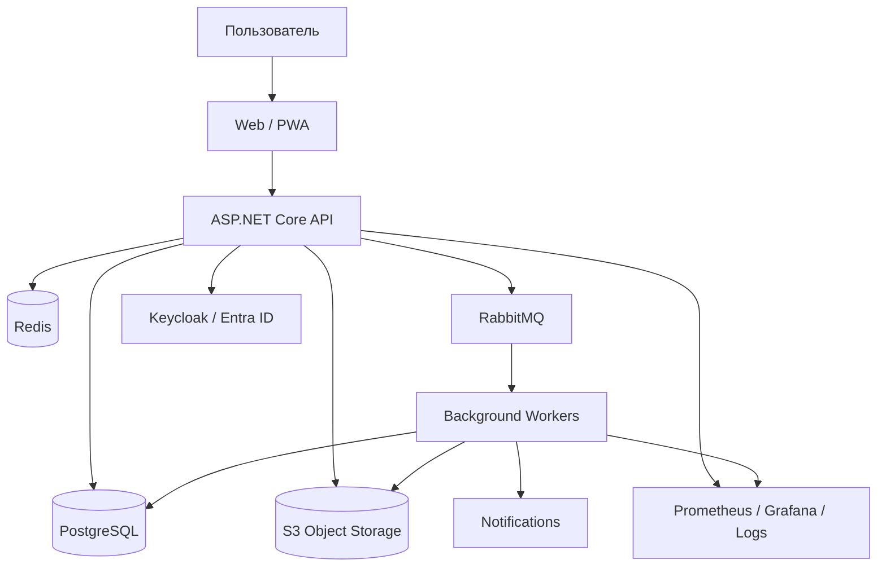

# АС «Эксплуатация» — архитектура системы

## 1. Назначение документа

Этот документ описывает целевую техническую архитектуру АС «Эксплуатация».

Он является техническим продолжением:

- `concept.md`;
- `roadmap.md`;
- `Q&A.md`.

Документ предназначен для:

- архитектора проекта;
- разработчиков;
- Codex и других AI-агентов;
- DevOps;
- специалистов по информационной безопасности;
- будущей команды сопровождения.

Главная задача документа — зафиксировать технические границы системы и предотвратить архитектурный дрейф при длительной разработке.

---

# 2. Архитектурные принципы

## 2.1. Модульный монолит на первом этапе

На старте система реализуется как **модульный монолит**.

Это означает:

- единое приложение backend;
- единая основная PostgreSQL;
- строгие доменные модули;
- запрет хаотических зависимостей между модулями;
- внутренние контракты;
- возможность последующего выделения отдельных модулей в сервисы.

Не требуется начинать с микросервисов.

Причины:

- один основной разработчик;
- активное использование Codex;
- необходимость быстрых изменений;
- сложная предметная область;
- большое количество связанных транзакций;
- высокая стоимость distributed debugging.

---

## 2.2. Domain-first

Модель данных и API строятся от предметной области, а не от экранов.

Основные домены:

```text
Identity
Organization
Sites
Locations
Assets
Maintenance
WorkOrders
Measurements
Defects
Repairs
Inventory
Incidents
Changes
Documents
Contractors
Qualifications
Notifications
Audit
Reports
Integrations
```

---

## 2.3. История важнее текущего состояния

Система должна хранить:

- текущее состояние;
- историю изменений;
- кто изменил;
- когда;
- в каком контексте;
- почему.

Физическое удаление критичных бизнес-сущностей запрещено.

---

## 2.4. Разделение факта и интерпретации

Пример:

```text
Факт:
напряжение АКБ = 22.6 В

Интерпретация:
вне нормы

Действие:
создать замечание / дефект
```

Фактические данные должны сохраняться независимо от последующих правил интерпретации.

---

## 2.5. Версионирование бизнес-правил

Версионируются:

- регламенты ТО;
- шаблоны работ;
- нормативы;
- документы;
- правила периодичности;
- часть справочников.

Историческая работа должна ссылаться на версию, действовавшую в момент выполнения.

---

## 2.6. Расширяемость без переписывания ядра

Поздние модули:

- телеметрия;
- SCADA;
- склад;
- стоимость;
- RCA;
- knowledge base;
- predictive maintenance;
- impact analysis.

Архитектура должна позволять добавлять их через новые модули и события.

---

# 3. Общая схема системы



---

# 4. Предлагаемый технологический стек

## Backend

- .NET 10 LTS;
- ASP.NET Core;
- C#;
- EF Core;
- Dapper для тяжёлых аналитических запросов.

## Frontend

- React;
- TypeScript;
- React Query / TanStack Query;
- router;
- component library.

## Mobile

Первый этап:

- PWA.

Позднее при необходимости:

- React Native;
- Flutter;
- отдельный native client.

## Database

- PostgreSQL.

## Cache

- Redis.

## Message Broker

- RabbitMQ.

## Object Storage

- S3-compatible storage.

Environment policy:

- DEV: SeaweedFS по ADR-009;
- PROD: provider пока не выбран;
- application/domain layers используют только стандартный S3-compatible client/contract;
- SeaweedFS-specific API запрещён вне local infrastructure configuration.

Возможные production providers не являются принятым выбором:

- MinIO;
- AWS S3;
- корпоративное S3-хранилище.

## Identity Provider

Предпочтительно:

- корпоративный Entra ID / Active Directory.

Для автономного контура:

- Keycloak.

## Reverse Proxy

- Nginx;
- Traefik.

## Observability

- Prometheus;
- Grafana;
- Loki / OpenSearch;
- OpenTelemetry.

---

# 5. Структура решения backend

Пример:

```text
src/
├── Exploitation.Api
├── Exploitation.Application
├── Exploitation.Infrastructure
├── Exploitation.Shared
│
├── Modules/
│   ├── Identity/
│   ├── Organization/
│   ├── Sites/
│   ├── Assets/
│   ├── Maintenance/
│   ├── WorkOrders/
│   ├── Measurements/
│   ├── Defects/
│   ├── Repairs/
│   ├── Inventory/
│   ├── Incidents/
│   ├── Changes/
│   ├── Documents/
│   ├── Contractors/
│   ├── Qualifications/
│   ├── Notifications/
│   ├── Audit/
│   ├── Reports/
│   └── Integrations/
│
└── Workers/
    ├── ReportsWorker
    ├── NotificationsWorker
    ├── MediaWorker
    └── MaintenanceSchedulerWorker
```

---

# 6. Правила модульности

## 6.1. Модуль владеет своими данными

Пример:

`Assets` владеет:

- assets;
- asset_models;
- manufacturers;
- asset_relations;
- asset_events.

`Maintenance` не должен напрямую менять таблицы `Assets`.

---

## 6.2. Взаимодействие через application contracts

Допустимо:

```text
Maintenance
→ IAssetQueryService
→ получить характеристики актива
```

Не допускается:

```text
MaintenanceService
→ напрямую через DbContext
→ обновить Asset.Status
```

---

## 6.3. Межмодульные события

Используются domain/application events.

Примеры:

```text
AssetCommissioned
AssetReplaced
MaintenanceCompleted
DefectCreated
DefectClosed
IncidentCreated
InventoryCompleted
ChangeApproved
QualificationExpired
```

---

# 7. Модель данных

## 7.1. Основной подход

Используется реляционная модель PostgreSQL.

Основные сущности имеют:

```text
id UUIDv7
created_at
created_by
updated_at
updated_by
version
```

Где требуется:

```text
valid_from
valid_to
status
```

---

## 7.2. UUIDv7

Предпочтительный ID:

```text
UUIDv7
```

Причины:

- сортируемость;
- распределённая генерация;
- offline;
- отсутствие централизованного sequence bottleneck;
- удобство синхронизации.

---

# 8. Схемы PostgreSQL

Рекомендуется разделять модули схемами.

Пример:

```text
identity.*
organization.*
sites.*
assets.*
maintenance.*
workorders.*
measurements.*
defects.*
inventory.*
incidents.*
changes.*
documents.*
audit.*
```

Это помогает:

- видеть владельца таблицы;
- ограничивать cross-module SQL;
- облегчить будущее разделение сервисов.

---

# 9. Organization

Ключевые сущности:

```text
Company
TerritorialZone
Region
OrganizationalUnit
Department
FunctionalDirection
Team
```

Организационная и географическая структуры не должны быть одной таблицей.

Пример:

```text
География:
Компания → зона → регион → объект

Оргструктура:
Компания → департамент → отдел → направление
```

Они пересекаются через назначения ответственности.

---

# 10. Sites

## 10.1. Site

Основные поля:

```text
id
code
name
site_type_id
criticality_class_id
region_id
status
address_text
timezone
row_version
```

For the TASK-02.03.03 first slice, `address_text` is required and no
coordinates or commissioning/closure timestamps are part of the Site
contract. Site ownership and target-aware scope are documented in
`modules/sites.md` and ADR-014. The Site B1 domain/persistence foundation is
published on main. SITE-AUTH-01 / ADR-017 also publishes exact Identity Site
scopes and Sites-owned direct/create/list authorization. SITE-API-01 implements
Site HTTP routes locally using that foundation and B1 mutation paths; separate
security/integration review precedes publication. Published Zone/Region routes
remain unchanged. Site frontend/capabilities/DEV bootstrap remain unimplemented.

## 10.2. SiteType

Справочник:

- retail_office;
- administration;
- warehouse;
- technical;
- custom.

Не hardcode.

These are conceptual examples, not the approved initial seed. The exact
SiteType seed and display names are recorded in `reference-data-registry.md`.

## 10.3. SiteCriticality

Справочник:

- KVO1;
- KVO2;
- KVO3;
- NORMAL.

---

# 11. Locations

Используется иерархическое дерево.

```text
Location
id
site_id
parent_id
type
name
code
```

Примеры:

```text
корпус
этаж
помещение
стойка
зона
площадка
```

Должна поддерживаться произвольная глубина.

---

# 12. Assets

## 12.1. Основные сущности

```text
AssetType
Manufacturer
AssetModel
Asset
AssetAttributeDefinition
AssetAttributeValue
AssetRelation
AssetEvent
AssetResponsibility
```

---

## 12.2. Asset

Пример полей:

```text
id
site_id
location_id
asset_type_id
model_id
parent_asset_id
serial_number
inventory_number
status
condition
commissioned_at
manufactured_at
decommissioned_at
```

---

## 12.3. Атрибуты

Используется гибридный подход.

Критичные поля — отдельными колонками.

Специфические характеристики — через:

```text
AssetAttributeDefinition
AssetAttributeValue
```

Либо JSONB там, где данные не участвуют в сложной аналитике.

Не рекомендуется полностью EAV-модель.

---

# 13. Asset Relations

Структурные связи:

```text
PARENT_OF
COMPONENT_OF
PART_OF_SYSTEM
```

Функциональные:

```text
POWERS
COOLS
CONTROLS
MONITORS
BACKS_UP
DEPENDS_ON
CONNECTS_TO
```

Связь:

```text
source_asset_id
target_asset_id
relation_type
valid_from
valid_to
metadata
```

---

# 14. Asset Responsibilities

Одна запись:

```text
asset_id
responsibility_type
subject_type
subject_id
valid_from
valid_to
```

`responsibility_type`:

- OWNER;
- BALANCE_HOLDER;
- FUNCTIONAL_OWNER;
- TECHNICAL_OWNER;
- SERVICE_PROVIDER;
- ASSIGNED_USER;
- CURATOR.

`subject_type`:

- User;
- Team;
- Organization;
- Contractor.

---

# 15. Maintenance

## 15.1. Основные сущности

```text
MaintenanceTemplate
MaintenanceTemplateVersion
MaintenanceOperation
MaintenanceRule
MaintenanceSchedule
MaintenancePlan
```

---

## 15.2. Maintenance Template

Шаблон связан с:

- asset type;
- system type;
- maintenance level;
- optional conditions.

---

## 15.3. Versioning

```text
Template v1
Template v2
Template v3
```

WorkOrder хранит snapshot версии.

---

# 16. Правила периодичности

Пример структуры:

```text
MaintenanceFrequencyRule

asset_type_id
maintenance_level
site_criticality
interval_type
interval_value
priority
valid_from
valid_to
```

Пример:

```text
ДГУ + ТО2 + NORMAL = 6 месяцев
ДГУ + ТО2 + KVO2 = 3 месяца
ДГУ + ТО2 + KVO1 = 1 месяц
```

Самое специфичное правило имеет больший приоритет.

---

# 17. Scheduler

Отдельный worker отвечает за:

- генерацию будущих WorkOrder;
- пересчёт календаря;
- обновление due dates;
- контроль просрочек;
- уведомления.

Scheduler не должен менять уже начатые WorkOrder.

---

# 18. WorkOrders

## 18.1. Основные сущности

```text
WorkOrder
WorkOrderParticipant
WorkOrderStep
WorkOrderMeasurement
WorkOrderMaterialUsage
WorkOrderLabor
WorkOrderAttachment
WorkOrderStatusHistory
```

---

## 18.2. WorkOrder Snapshot

При создании задания копируются:

- операции;
- нормативы;
- единицы;
- обязательность;
- версия регламента;
- требования к квалификациям.

Изменение шаблона не изменяет существующую работу.

---

# 19. Measurements

Отдельная таблица временных рядов:

```text
Measurement
id
asset_id
component_id
parameter_code
value_numeric
value_text
unit
measured_at
source
work_order_id
status
```

Крупную таблицу следует партиционировать по времени.

---

# 20. Defects

Основные сущности:

```text
Defect
DefectObservation
DefectStatusHistory
DefectResolution
DefectLink
```

`DefectObservation` позволяет не плодить дубли при повторном обнаружении.

---

# 21. Repairs

```text
Repair
RepairAction
ReplacedComponent
RepairMaterial
RepairWarranty
RepairAttachment
```

Ремонт может:

- закрыть дефект;
- заменить актив;
- создать гарантию;
- изменить состояние актива.

---

# 22. Incident Management

Сущности:

```text
Incident
IncidentTimeline
IncidentParticipant
IncidentAffectedAsset
IncidentReview
```

Для P1/P2:

```text
IncidentReview required
```

---

# 23. Change Management

Сущности:

```text
Change
ChangeTask
ChangeWindow
ChangeRiskAssessment
ChangeApproval
ResidualRiskAcceptance
RollbackPlan
ChangeResult
```

---

# 24. Risk Model

Автоматическая оценка и экспертные оценки хранятся отдельно.

```text
AutoRiskScore
ExpertRiskAssessment
FinalRiskDecision
```

Нельзя перезаписывать экспертные оценки итоговым решением.

---

# 25. Inventory

Основные сущности:

```text
InventorySession
InventoryScope
InventoryParticipant
InventoryExpectedItem
InventoryObservation
InventoryDiscrepancy
InventoryReport
```

---

## 25.1. InventoryObservation

Каждый факт сканирования:

```text
asset_id
user_id
scanned_at
actual_location_id
result
photo_ids
```

---

# 26. Documents

## 26.1. Metadata

В PostgreSQL:

```text
Document
DocumentVersion
DocumentLink
```

## 26.2. File

В S3:

```text
storage_key
hash
content_type
size
```

---

# 27. Object Storage

Рекомендуемая логическая структура:

```text
/{tenant}
/assets/{assetId}
/workorders/{workOrderId}
/incidents/{incidentId}
/changes/{changeId}
/documents/{documentId}/versions/{versionId}
```

Не следует привязывать физическую структуру bucket к человекочитаемым названиям объектов.

---

# 28. Media Processing

Background worker:

- создаёт preview;
- создаёт thumbnail;
- извлекает metadata;
- проверяет hash;
- антивирусная проверка при необходимости.

---

# 29. Auth

## 29.1. Authentication

OIDC / OAuth2.

Backend не хранит пользовательские пароли.

---

## 29.2. Authorization

Модель:

```text
RBAC
+
ABAC / Scope
```

Пример:

```text
Role = Engineer
Region = 03
Direction = Exploitation
AssetTypes = UPS, DGU
Actions = Read, ExecuteWork
```

---

# 30. Contractor Access

Контекст доступа:

```text
User
→ ContractorOrganization
→ Contract
→ Assignment
→ Scope
```

После окончания договора:

```text
scope disabled
account remains
history remains
```

---

# 31. Row-Level Security

Для критичных таблиц возможно использование PostgreSQL RLS как дополнительного барьера.

Но RLS не заменяет application authorization.

Рекомендуемый порядок:

```text
Application authorization
+
database RLS for critical boundaries
```

---

# 32. Audit

Audit должен быть append-only.

```text
AuditEvent
id
timestamp
user_id
acting_context
action
entity_type
entity_id
before
after
reason
ip
user_agent
```

Для критичных событий нельзя разрешать edit/delete audit.

---

# 33. Event Bus

Внутри монолита:

- in-process events.

Для надёжных событий:

- transactional outbox.

Дальше:

```text
PostgreSQL
→ Outbox
→ Publisher
→ RabbitMQ
→ Worker / Integration
```

---

# 34. Outbox Pattern

Нужен для:

- уведомлений;
- генерации документов;
- синхронизаций;
- интеграций;
- тяжёлых фоновых задач.

Транзакция:

```text
Business data
+
Outbox event
```

записывается атомарно.

---

# 35. RabbitMQ

Используется для:

- тяжёлых отчётов;
- image processing;
- уведомлений;
- массовых импортов;
- будущих интеграций.

Не использовать RabbitMQ для обычного CRUD.

---

# 36. Redis

Используется для:

- caching;
- distributed lock;
- rate limiting;
- short-lived sessions;
- expensive lookup cache.

Redis не является source of truth.

---

# 37. API

REST API.

Пример:

```text
/api/v1/sites
/api/v1/assets
/api/v1/maintenance/templates
/api/v1/work-orders
/api/v1/defects
/api/v1/incidents
```

OpenAPI обязателен.

---

# 38. API Guidelines

Основные правила:

- versioned API;
- idempotency key для повторяемых операций;
- pagination;
- filtering;
- sorting;
- consistent errors;
- correlation id.

---

# 39. Ошибки

Стандарт:

```json
{
  "code": "ASSET_NOT_FOUND",
  "message": "Asset was not found",
  "correlationId": "..."
}
```

Не возвращать stack trace пользователю.

---

# 40. Concurrency

Используется optimistic locking.

Пример:

```text
row_version
```

Если два пользователя редактируют актив:

- второй получает conflict;
- UI показывает изменения.

---

# 41. Soft Delete

Используется только где уместно.

Для бизнес-истории предпочтительнее status lifecycle.

Пример:

```text
Asset:
ACTIVE → DECOMMISSIONED
```

а не:

```text
is_deleted = true
```

---

# 42. Background Jobs

Категории:

- scheduler;
- reports;
- notifications;
- document processing;
- imports;
- cleanup;
- integration sync.

---

# 43. Reports

Отчёты не строятся тяжёлым SQL прямо внутри HTTP-request.

Поток:

```text
User
→ GenerateReport
→ Queue
→ ReportWorker
→ File
→ Notification
```

---

# 44. Search

На первом этапе:

- PostgreSQL indexes;
- full-text search;
- trigram indexes.

OpenSearch добавляется только при доказанной необходимости.

---

# 45. Масштабирование PostgreSQL

Первые меры:

- правильные индексы;
- partitioning;
- connection pooling;
- read replicas для тяжёлых отчётов.

Не требуется sharding на первом этапе.

---

# 46. Партиционирование

Кандидаты:

```text
audit_events
measurements
work_order_steps
asset_events
notifications
integration_events
```

Партиционирование по времени.

---

# 47. Масштабирование приложения

Backend должен быть stateless.

Это позволяет:

```text
1 instance
→ 2
→ 4
→ N
```

через load balancer.

---

# 48. Deployment

Первый промышленный вариант:

```text
Reverse Proxy
↓
2+ API instances
↓
PostgreSQL
Redis
RabbitMQ
Object Storage
Workers
```

---

# 49. Kubernetes

Не использовать на старте без необходимости.

Первый этап:

- Docker;
- Docker Compose;
- systemd / container runtime;
- reverse proxy.

Kubernetes — только при реальной потребности.

---

# 50. Environments

Минимум:

```text
DEV
TEST
STAGE
PROD
```

Данные PROD не копируются в DEV без анонимизации.

---

# 51. CI/CD

Pipeline:

```text
restore
build
lint
unit tests
integration tests
migration check
security scan
build image
deploy stage
smoke test
manual approval
deploy prod
```

---

# 52. Database Migrations

Миграции:

- version controlled;
- forward-only;
- reviewed;
- tested on staging.

Критичные изменения выполняются expand/contract pattern.

Business module владеет своим `DbContext`, PostgreSQL schema и migrations. Технический `Exploitation.DatabaseMigrator` только обнаруживает зарегистрированные module contexts и последовательно применяет их migrations; он не владеет schema или global `DbContext`. Единый connection contract: `ConnectionStrings:Database`. Решение зафиксировано в `ADR-010`.

---

# 53. Backup

PostgreSQL:

- daily full;
- WAL archiving;
- PITR.

Object storage:

- versioning;
- replication;
- lifecycle policy.

---

# 54. Disaster Recovery

Документировать:

- RPO;
- RTO;
- restore procedures;
- failover.

На старте ориентир задаётся бизнесом.

---

# 55. Observability

## Metrics

- request rate;
- errors;
- latency;
- queue length;
- DB connections;
- slow queries;
- storage usage.

## Logs

Structured JSON logs.

## Tracing

OpenTelemetry.

Каждый запрос получает correlation ID.

---

# 56. Security

Минимальный набор:

- TLS;
- OIDC;
- RBAC;
- scope restrictions;
- audit;
- secrets management;
- dependency scanning;
- upload validation;
- rate limiting.

---

# 57. Upload Security

Для файлов:

- size limit;
- content type check;
- extension validation;
- malware scan;
- checksum;
- quarantine при необходимости.

---

# 58. Sensitive Documents

Для документов:

- access classification;
- download permission;
- audit download;
- signed temporary URLs.

---

# 59. Offline Architecture

Поздний этап.

PWA хранит локально:

- work order snapshot;
- checklist;
- measurements;
- drafts;
- media queue.

---

# 60. Offline IDs

UUIDv7 позволяет создавать сущности offline.

---

# 61. Sync

Клиент отправляет операции:

```text
operationId
entityId
timestamp
payload
```

Server использует idempotency.

---

# 62. Conflict Resolution

Пример:

```text
Client A changed location
Client B changed serial number
```

Возможен merge.

Но:

```text
A changed location
B changed same location
```

→ conflict.

---

# 63. Mobile Media

Фото загружаются отдельно от основной транзакции.

Порядок:

```text
создать draft work
→ загрузить media
→ подтвердить completion
```

---

# 64. Integration Layer

Поздние внешние системы не должны напрямую писать в domain tables.

Использовать:

```text
Integration Adapter
→ Application API
→ Domain
```

---

# 65. External IDs

Для активов:

```text
ExternalIdentifier
system
external_id
entity_type
entity_id
```

Позволяет связывать:

- ERP;
- SCADA;
- ITSM;
- monitoring;
- finance systems.

---

# 66. Telemetry

Поздний модуль.

Не писать телеметрию непосредственно в основную таблицу `assets`.

Отдельно:

```text
TelemetrySource
TelemetryPoint
TelemetryReading
```

---

# 67. Future Service Extraction

Наиболее вероятные кандидаты:

- Documents / Media;
- Notifications;
- Reports;
- Telemetry;
- Search;
- Integrations.

Core domains лучше дольше оставлять вместе:

- Assets;
- Maintenance;
- WorkOrders;
- Defects.

---

# 68. Frontend Architecture

Пример:

```text
src/
├── app/
├── shared/
├── entities/
├── features/
├── widgets/
└── pages/
```

Рекомендуется feature/domain oriented структура.

---

# 69. Frontend Permissions

UI permission check не считается защитой.

Frontend скрывает действия.

Backend всегда повторно проверяет permission.

---

# 70. Основные пользовательские маршруты

## Asset

```text
Object
→ System
→ Asset
→ History
```

## Maintenance

```text
Calendar
→ Work Order
→ Checklist
→ Result
```

## Defect

```text
Defect
→ Repair
→ Verification
```

## Inventory

```text
Session
→ Scan
→ Discrepancy
→ Report
```

---

# 71. Performance Targets

Целевые ориентиры первого промышленного этапа:

- обычный API request p95 < 500 ms;
- открытие карточки объекта < 2 s;
- поиск актива < 1 s при индексированных полях;
- тяжёлые отчёты — background job;
- media upload — chunked/resumable при необходимости.

---

# 72. Volume Assumptions

Ориентиры:

```text
Objects:
5 000+

Assets:
500 000–1 000 000+

Users:
10 000+

WorkOrders:
millions/year

Measurements:
tens of millions/year

Photos:
millions/year
```

Архитектура должна быть готова к росту без sharding на первом этапе.

---

# 73. Data Retention

Для каждого типа данных задаётся политика.

Пример:

```text
audit — долгосрочно
asset history — бессрочно
work history — бессрочно
temporary exports — 30 дней
notifications — configurable
```

---

# 74. Audit vs Business History

Это разные вещи.

Business history:

```text
что произошло с оборудованием
```

Audit:

```text
кто изменил запись в системе
```

Они не заменяют друг друга.

---

# 75. Event History

У активов хранится timeline:

```text
Commissioned
MaintenanceCompleted
DefectOpened
RepairCompleted
Moved
Replaced
InventoryVerified
```

---

# 76. Approval Engine

На первом этапе не использовать полноценный BPMN.

Достаточно:

```text
ApprovalRequest
ApprovalStep
ApprovalDecision
```

С настраиваемыми простыми цепочками.

---

# 77. Configurable Rules

Для первых версий:

- простые таблицы правил;
- без DSL;
- без complex workflow engine.

Пример:

```text
IF SiteCriticality = KVO1
AND ChangeRisk >= HIGH
THEN ManagerApprovalRequired = true
```

---

# 78. Feature Flags

Для неприоритетных функций использовать feature flags.

Примеры:

- cost tracking;
- advanced contract fields;
- travel time;
- batch tracking;
- advanced risk;
- working hours planning.

---

# 79. Multi-Tenant Considerations

Система корпоративная, не SaaS multi-tenant.

Но логически существуют security boundaries:

- internal;
- contractor;
- contract scope;
- region;
- object.

Не использовать классический tenant_id как замену полноценной access model.

---

# 80. Import Strategy

Массовые импорты:

- CSV;
- XLSX;
- API.

Поток:

```text
Upload
→ Validation
→ Preview
→ Errors
→ Confirm
→ Background Import
→ Report
```

Никогда не писать импорт напрямую в production tables без validation stage.

---

# 81. Data Quality

Master data:

- manufacturers;
- models;
- asset types;
- units;
- document types;
- defect types.

Изменение master data:

```text
proposal
→ verification
→ publication
```

---

# 82. Units

Создать единый справочник единиц измерения.

Не хранить:

```text
V
Volt
В
вольт
```

как разные единицы.

---

# 83. Time

В БД:

```text
UTC
```

В UI:

```text
local timezone
```

Для объектов желательно хранить timezone.

---

# 84. Localization

Архитектурно предусмотреть локализацию.

Первый язык:

- русский.

Не hardcode пользовательские строки в business layer.

---

# 85. Notification Architecture

Событие:

```text
Domain Event
→ Notification Rule
→ Recipient Resolver
→ Channel
```

Каналы:

- in-app;
- email;
- later: messengers / SMS.

---

# 86. Notification Preferences

Позже пользователь сможет выбрать:

- immediate;
- digest;
- disabled where permitted.

---

# 87. Reporting Architecture

Операционные отчёты:

- напрямую из основной БД при безопасных запросах.

Тяжёлая аналитика:

- read replica;
- materialized views;
- позже DWH.

---

# 88. DWH

Не требуется на старте.

Добавляется при росте аналитики.

---

# 89. Test Architecture

## Unit

Domain rules.

## Integration

PostgreSQL + application.

## Authorization

Обязательные tests.

## Contract

API schemas.

## E2E

Критические пользовательские сценарии.

---

# 90. Critical E2E Scenarios

Минимальный набор:

1. Создание объекта.
2. Добавление актива.
3. Назначение ответственности.
4. Генерация ТО.
5. Выполнение ТО подрядчиком.
6. Проверка заказчиком.
7. Создание дефекта.
8. Ремонт.
9. Инвентаризация.
10. Missing asset.
11. Incident P1.
12. Change на КВО.
13. Истечение допуска.
14. Истечение договора подрядчика.

---

# 91. Coding Rules for AI Agents

AI-агент обязан:

- сначала читать `concept.md`;
- читать `architecture.md`;
- читать релевантный модуль;
- не менять архитектурные границы без ADR;
- добавлять tests;
- обновлять документацию.

---

# 92. ADR

Создать:

```text
/docs/adr/
```

Пример:

```text
ADR-001 Modular Monolith
ADR-002 PostgreSQL
ADR-003 UUIDv7
ADR-004 S3 storage
ADR-005 Outbox
```

---

# 93. Когда нужен ADR

Если решение:

- влияет на несколько модулей;
- сложно откатить;
- меняет storage;
- меняет auth;
- меняет messaging;
- меняет API style;
- меняет deployment.

---

# 94. Definition of Architecture Compliance

Изменение считается архитектурно корректным, если:

1. Не нарушает ownership модуля.
2. Не создаёт прямой cross-module database write.
3. Имеет audit.
4. Учитывает permissions.
5. Сохраняет историю.
6. Имеет tests.
7. Не ломает versioning.
8. Имеет migration.
9. Имеет documented API.
10. Не вводит новый infrastructure component без ADR.

---

# 95. Целевая эволюция

## Phase A

```text
Modular Monolith
Single PostgreSQL
Single S3
RabbitMQ
Redis
```

## Phase B

```text
Horizontal API scaling
Workers
Read replica
Partitioning
```

## Phase C

При необходимости:

```text
Documents Service
Reports Service
Notifications Service
Telemetry Service
Integration Service
```

Core остаётся максимально целостным.

---

# 96. Главный архитектурный принцип

> Не строить сложную распределённую платформу раньше, чем сложность предметной области стабилизирована.

Сначала:

```text
корректная доменная модель
+
надёжная история
+
права
+
ТО
+
дефекты
+
инвентаризация
```

Затем:

```text
масштабирование
+
автоматизация
+
интеграции
+
аналитика
+
телеметрия
```

---

# 97. Итог

Целевая архитектура АС «Эксплуатация»:

```text
Web / PWA
        │
        ▼
ASP.NET Core Modular Monolith
        │
 ┌──────┼─────────────┐
 ▼      ▼             ▼
PG    Redis        RabbitMQ
        │             │
        │             ▼
        │          Workers
        │
        ▼
    Fast cache

Files
  │
  ▼
S3 Object Storage

Identity
  │
  ▼
Keycloak / Entra ID
```

Система должна оставаться технически простой настолько долго, насколько это возможно, но иметь строгие доменные границы, позволяющие масштабировать отдельные части без переписывания ядра.
