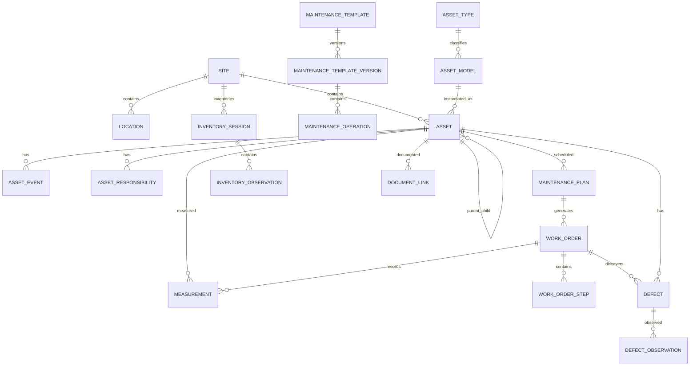

# АС «Эксплуатация» — Database Design

## 1. Назначение документа

Этот документ определяет целевую структуру данных АС «Эксплуатация» в PostgreSQL.

Документ является техническим продолжением:

- `concept.md`;
- `roadmap.md`;
- `architecture.md`;
- `coding-standards.md`;
- `Q&A.md`.

Он предназначен для:

- разработки миграций;
- проектирования EF Core entities/configurations;
- Dapper/read-model запросов;
- code review;
- Codex и других AI-агентов;
- DBA;
- аналитиков;
- будущего масштабирования.

Документ описывает **логическую целевую модель**, а не обязательный набор таблиц первого релиза.

Часть таблиц реализуется по этапам roadmap.

---

# 2. Общие принципы БД

## 2.1. СУБД

```text
PostgreSQL
```

---

## 2.2. Тип идентификатора

Основные бизнес-сущности:

```text
UUIDv7
```

В PostgreSQL:

```sql
uuid
```

ID предпочтительно генерируется приложением.

---

## 2.3. Время

Все временные поля:

```text
timestamptz
```

Хранятся в UTC.

Поля только даты:

```text
date
```

---

## 2.4. Именование

Таблицы и поля:

```text
snake_case
```

Таблицы:

```text
plural
```

Пример:

```text
assets
work_orders
asset_events
```

---

## 2.5. Базовые audit columns

Большинство изменяемых таблиц имеют:

```text
id
created_at
created_by
updated_at
updated_by
row_version
```

`row_version` используется для optimistic concurrency.

В PostgreSQL можно реализовать bigint version либо application-managed token.

---

## 2.6. Историчность

Если сущность имеет бизнес-жизненный цикл, её не удаляют физически.

Используются:

- status;
- valid_from;
- valid_to;
- history tables;
- event tables.

---

## 2.7. Справочники

Бизнес-редактируемые значения не должны быть C# enum, если их требуется менять без релиза.

Примеры справочников:

- site_types;
- asset_types;
- manufacturers;
- units;
- document_types;
- defect_types.

---

# 3. PostgreSQL schemas

Рекомендуемая структура:

```text
identity
organization
sites
assets
maintenance
workorders
measurements
defects
repairs
inventory
incidents
changes
documents
contractors
qualifications
notifications
audit
integrations
reporting
shared
```

---

# 4. Shared schema

## 4.1. shared.units

Единицы измерения.

```text
id                  uuid PK
code                varchar(50) unique
name                varchar(200)
symbol              varchar(50)
quantity_type       varchar(100)
is_active           boolean
created_at          timestamptz
```

Примеры:

```text
V
A
kW
kVA
°C
bar
mΩ
l
h
```

---

## 4.2. shared.currencies

Поздний финансовый блок.

```text
code                char(3) PK
name                varchar(100)
is_active           boolean
```

---

## 4.3. shared.tags

Опциональная общая система тегов.

```text
id
code
name
category
```

Не использовать теги вместо нормальной предметной модели.

---

# 5. Identity schema

## 5.1. identity.users

Локальный профиль пользователя.

Authentication выполняется внешним IdP.

```text
id                  uuid PK
external_issuer     varchar(2048)
external_subject    varchar(255)
display_name        varchar(300)
email               varchar(320)
user_type           varchar(50)
status              varchar(50)
created_at          timestamptz
updated_at          timestamptz
row_version         bigint
```

`user_type`:

```text
INTERNAL
CONTRACTOR
SYSTEM
```

`status`:

```text
ACTIVE
INACTIVE
```

Canonical external identity и unique constraint:

```text
(external_issuer, external_subject)
```

`external_issuer` и `external_subject` сохраняются как opaque exact values без trim/case normalization. `display_name` и `email` синхронизируются из bounded optional claims validated token; oversized значения игнорируются. Они не являются identity key. Синхронизация не меняет сохранённые `user_type` и `status`; `row_version` защищает от silent overwrite. Поля `login` и `default_timezone` отложены до появления подтверждённых use cases.

---

## 5.2. identity.roles

```text
id
code
name
description
is_system
is_active
```

---

## 5.3. identity.permissions

```text
id
code
name
module
description
```

Примеры:

```text
assets.read
assets.create
assets.change
maintenance.execute
workorders.approve
inventory.execute
incidents.manage
```

---

## 5.4. identity.role_permissions

```text
role_id             FK roles
permission_id       FK permissions
```

PK:

```text
(role_id, permission_id)
```

---

## 5.5. identity.access_assignments

Ключевая таблица scope-based access.

```text
id
user_id
role_id
context_type
context_id
territorial_zone_id nullable
region_id           nullable
site_id             nullable
functional_direction_id nullable
asset_type_id       nullable
valid_from
valid_to
is_active
created_at
created_by
```

`context_type`:

```text
INTERNAL
CONTRACT
PROJECT
DELEGATION
TEAM
```

Одна запись не обязана заполнять все scope fields.

---

## 5.6. identity.user_contexts

Рабочие контексты пользователя.

```text
id
user_id
context_type
context_entity_id
name
valid_from
valid_to
is_active
```

---

# 6. Organization schema

## 6.1. organization.companies

```text
id
code
name
status
```

---

## 6.2. organization.territorial_zones

```text
id
company_id
code
name
status
```

---

## 6.3. organization.regions

```text
id
territorial_zone_id
code
name
timezone
status
```

---

## 6.4. organization.organizational_units

Универсальное дерево оргструктуры.

```text
id
company_id
parent_id           nullable
unit_type
code
name
status
```

Примеры `unit_type`:

```text
DEPARTMENT
DIVISION
DIRECTION
SECTION
FRONT_OFFICE
BACK_OFFICE
MANAGEMENT
```

---

## 6.5. organization.functional_directions

Функциональные вертикали.

```text
id
code
name
description
is_active
```

Примеры:

```text
IT
EXPLOITATION
SECURITY
CYBERSECURITY
REAL_ESTATE
INFRASTRUCTURE_DEVELOPMENT
RETAIL
```

---

## 6.6. organization.teams

Рабочие группы.

```text
id
organizational_unit_id nullable
functional_direction_id nullable
code
name
team_type
status
created_at
```

---

## 6.7. organization.team_members

```text
team_id
user_id
member_role
valid_from
valid_to
```

---

## 6.8. organization.delegations

```text
id
from_user_id
to_user_id
scope_type
scope_id
valid_from
valid_to
reason
created_by
created_at
status
```

---

# 7. Sites schema

## 7.1. sites.site_types

```text
id
code
name
description
is_active
```

Примеры:

```text
RETAIL_OFFICE
ADMIN_BUILDING
WAREHOUSE
TECHNICAL_SITE
```

---

## 7.2. sites.site_criticality_classes

```text
id
code
name
rank
description
is_active
```

Примеры:

```text
NORMAL
KVO3
KVO2
KVO1
```

`rank` позволяет сравнивать уровни без hardcode.

---

## 7.3. sites.sites

```text
id
region_id
code
name
site_type_id
criticality_class_id
status
address_text
latitude            nullable
longitude           nullable
timezone
commissioned_at     nullable
closed_at           nullable
created_at
created_by
updated_at
updated_by
row_version
```

Indexes:

```text
ux_sites_code
ix_sites_region_id
ix_sites_site_type_id
ix_sites_criticality_class_id
ix_sites_status
```

---

## 7.4. sites.locations

Иерархия мест.

```text
id
site_id
parent_id           nullable
location_type_id
code
name
description
is_active
created_at
updated_at
row_version
```

Index:

```text
ix_locations_site_id_parent_id
```

---

## 7.5. sites.location_types

```text
id
code
name
```

Примеры:

```text
BUILDING
FLOOR
ROOM
RACK
AREA
PLATFORM
```

---

## 7.6. sites.site_operating_schedules

Поздняя функция.

```text
id
site_id
day_of_week
open_time
close_time
valid_from
valid_to
```

---

## 7.7. sites.site_service_windows

Поздняя функция.

```text
id
site_id
name
window_type
start_rule
end_rule
description
```

---

# 8. Contractors schema

## 8.1. contractors.organizations

```text
id
code
name
tax_identifier      nullable
status
created_at
```

---

## 8.2. contractors.contracts

Первый этап — минимальная модель.

```text
id
contractor_organization_id
contract_number
name
valid_from
valid_to
status
responsible_user_id nullable
created_at
updated_at
```

---

## 8.3. contractors.contract_scopes

Область доступа.

```text
id
contract_id
region_id           nullable
site_id             nullable
functional_direction_id nullable
asset_type_id       nullable
work_type_code      nullable
permission_code     nullable
valid_from
valid_to
```

---

## 8.4. contractors.user_memberships

Один человек может работать в нескольких подрядных организациях.

```text
id
user_id
contractor_organization_id
valid_from
valid_to
status
```

---

## 8.5. contractors.user_contract_assignments

```text
id
user_id
contract_id
valid_from
valid_to
status
verified_by
verified_at
```

---

# 9. Assets master data

## 9.1. assets.asset_types

```text
id
parent_id           nullable
code
name
functional_direction_id
is_system_type      boolean
is_component_type   boolean
is_active
```

Позволяет иерархию:

```text
Engineering Equipment
→ Power
→ UPS
```

---

## 9.2. assets.manufacturers

```text
id
code
name
normalized_name
status
verified_at
verified_by
```

Unique:

```text
normalized_name
```

---

## 9.3. assets.asset_models

```text
id
asset_type_id
manufacturer_id
model_code
name
description
status
verified_at
verified_by
created_at
```

Unique candidate:

```text
(manufacturer_id, asset_type_id, normalized model_code)
```

---

## 9.4. assets.model_attribute_values

Заводские характеристики модели.

```text
id
model_id
attribute_definition_id
value_text           nullable
value_numeric        nullable
unit_id              nullable
valid_from
valid_to
```

---

# 10. Asset attributes

## 10.1. assets.attribute_definitions

```text
id
asset_type_id        nullable
code
name
data_type
unit_id              nullable
is_required
is_searchable
is_reportable
validation_json      jsonb nullable
is_active
```

`data_type`:

```text
TEXT
NUMBER
BOOLEAN
DATE
DATETIME
REFERENCE
```

---

## 10.2. assets.asset_attribute_values

```text
id
asset_id
attribute_definition_id
value_text           nullable
value_numeric        nullable
value_boolean        nullable
value_date           nullable
reference_id         nullable
valid_from
valid_to
created_at
created_by
```

Для часто используемых ключевых полей использовать реальные колонки `assets`.

---

# 11. Core assets

## 11.1. assets.assets

```text
id
site_id
location_id
asset_type_id
model_id             nullable
parent_asset_id      nullable

asset_code
inventory_number     nullable
serial_number        nullable
serial_number_normalized nullable

lifecycle_status
technical_condition
availability_status

manufactured_at      nullable
installed_at         nullable
commissioned_at      nullable
decommissioned_at    nullable

warranty_until       nullable

created_at
created_by
updated_at
updated_by
row_version
```

Indexes:

```text
ux_assets_asset_code
ix_assets_site_id
ix_assets_location_id
ix_assets_asset_type_id
ix_assets_model_id
ix_assets_parent_asset_id
ix_assets_serial_number_normalized
ix_assets_site_id_lifecycle_status
```

---

## 11.2. lifecycle_status

На первом этапе может быть enum/lookup:

```text
PLANNED
WAREHOUSE
INSTALLED
COMMISSIONED
IN_OPERATION
RESERVE
REPAIR
DECOMMISSIONED
DISPOSED
```

---

## 11.3. technical_condition

```text
NORMAL
ATTENTION
DEGRADED
FAULT
CRITICAL
UNKNOWN
```

---

## 11.4. availability_status

```text
AVAILABLE
PARTIALLY_AVAILABLE
UNAVAILABLE
UNKNOWN
```

---

# 12. Asset relations

## 12.1. assets.asset_relation_types

```text
id
code
name
category
is_directional
is_active
```

`category`:

```text
STRUCTURAL
FUNCTIONAL
REDUNDANCY
```

---

## 12.2. assets.asset_relations

```text
id
source_asset_id
target_asset_id
relation_type_id
valid_from
valid_to
metadata_json        jsonb
created_at
created_by
```

Indexes:

```text
ix_asset_relations_source
ix_asset_relations_target
ix_asset_relations_type
```

---

# 13. Asset responsibility

## 13.1. assets.responsibility_types

```text
id
code
name
```

Примеры:

```text
OWNER
BALANCE_HOLDER
FUNCTIONAL_OWNER
TECHNICAL_OWNER
SERVICE_PROVIDER
ASSIGNED_USER
CURATOR
APPROVER
```

---

## 13.2. assets.asset_responsibilities

```text
id
asset_id
responsibility_type_id

subject_type
user_id              nullable
team_id              nullable
organization_unit_id nullable
contractor_organization_id nullable

valid_from
valid_to

created_at
created_by
```

Check constraint:

ровно один subject FK заполнен.

---

# 14. Asset events

## 14.1. assets.asset_events

Бизнес-timeline актива.

```text
id
asset_id
event_type
occurred_at
recorded_at
recorded_by
source_type
source_id            nullable
summary
details_json         jsonb nullable
```

Примеры:

```text
CREATED
INSTALLED
COMMISSIONED
MOVED
MAINTENANCE_COMPLETED
DEFECT_CREATED
REPAIR_COMPLETED
COMPONENT_REPLACED
INVENTORY_VERIFIED
DECOMMISSIONED
```

Партиционирование:

```text
occurred_at
```

при существенном росте.

---

# 15. Asset replacement

## 15.1. assets.asset_replacements

```text
id
old_asset_id
new_asset_id
replacement_type
reason
performed_at
change_id            nullable
work_order_id        nullable
approved_by
approved_at
created_at
```

`replacement_type`:

```text
LIKE_FOR_LIKE
FUNCTIONAL_EQUIVALENT
CONFIGURATION_CHANGE
```

---

# 16. Warranty

## 16.1. assets.warranties

Универсальная гарантия.

```text
id
warranty_scope_type
asset_id             nullable
component_asset_id   nullable
repair_id            nullable
work_order_id        nullable

provider_type
contractor_organization_id nullable
manufacturer_id      nullable

starts_at
ends_at
description
document_id          nullable

created_at
created_by
```

---

# 17. Maintenance master data

## 17.1. maintenance.levels

```text
id
code
name
rank
description
is_active
```

Примеры:

```text
TO1
TO2
TO3
SEASONAL
MAJOR
```

---

## 17.2. maintenance.templates

Логическая сущность регламента.

```text
id
code
name
asset_type_id
maintenance_level_id
status
created_at
created_by
```

---

## 17.3. maintenance.template_versions

```text
id
template_id
version_number
status
valid_from
valid_to
approved_by
approved_at
created_at
created_by
change_summary
```

Statuses:

```text
DRAFT
REVIEW
APPROVED
ARCHIVED
```

Unique:

```text
(template_id, version_number)
```

---

# 18. Maintenance operations

## 18.1. maintenance.operation_definitions

Операция внутри версии.

```text
id
template_version_id
parent_operation_id nullable
operation_code
sequence_no
name
description

operation_type
requirement_type
criticality

parameter_code      nullable
unit_id             nullable
min_value           nullable
max_value           nullable
warning_min         nullable
warning_max         nullable

is_photo_required
is_comment_required
estimated_minutes   nullable

target_asset_type_id nullable
target_component_rule_json jsonb nullable

condition_json      jsonb nullable
```

`operation_type`:

```text
CHECK
BOOLEAN
NUMBER
TEXT
SELECT
PHOTO
MEASUREMENT
```

`requirement_type`:

```text
REQUIRED
CONDITIONAL
RECOMMENDED
CONTROL
```

`criticality`:

```text
MINOR
IMPORTANT
CRITICAL
```

---

# 19. Maintenance composition

## 19.1. maintenance.template_inclusions

Для ТО-2 включает ТО-1 и модульных регламентов.

```text
id
template_version_id
included_template_id
inclusion_type
condition_json
```

---

# 20. Maintenance frequency rules

## 20.1. maintenance.frequency_rules

```text
id
asset_type_id
maintenance_level_id
site_criticality_class_id nullable
site_type_id              nullable

interval_type
interval_value
interval_unit

priority
valid_from
valid_to
status

created_at
created_by
```

`interval_type`:

```text
CALENDAR
METER
COMBINED
SEASONAL
EVENT
```

Первый релиз может реализовывать только CALENDAR, но schema допускает расширение.

---

# 21. Maintenance plans

## 21.1. maintenance.asset_plans

Связь актива с регламентом.

```text
id
asset_id
template_id
frequency_rule_id
status
last_completed_at
next_due_at
schedule_anchor_at
created_at
updated_at
row_version
```

Индивидуальный override добавляется позднее.

---

## 21.2. maintenance.schedule_recalculations

История пересчётов.

```text
id
asset_plan_id
old_due_at
new_due_at
reason_type
reason_entity_id
reason_text
calculated_at
calculated_by_type
```

---

# 22. Work Orders

## 22.1. workorders.work_orders

```text
id
work_order_number
work_type
site_id
asset_id             nullable
system_asset_id      nullable
maintenance_plan_id  nullable
template_version_id  nullable

status
priority

planned_start_at     nullable
planned_end_at       nullable
actual_start_at      nullable
actual_end_at        nullable

assigned_team_id     nullable
contract_id          nullable

proposed_asset_condition nullable
approved_asset_condition nullable

created_at
created_by
updated_at
updated_by
row_version
```

Indexes:

```text
ux_work_orders_work_order_number
ix_work_orders_site_id_status
ix_work_orders_asset_id
ix_work_orders_planned_start_at
ix_work_orders_status
```

---

# 23. Work Order snapshot

## 23.1. workorders.work_order_steps

Snapshot операций.

```text
id
work_order_id
source_operation_definition_id nullable

sequence_no
name
description

operation_type
requirement_type
criticality

parameter_code      nullable
unit_id             nullable
min_value           nullable
max_value           nullable

status
result_text         nullable
result_numeric      nullable
result_boolean      nullable

completed_at        nullable
completed_by        nullable

comment             nullable

created_at
updated_at
row_version
```

Потенциально очень большая таблица.

Партиционирование по `created_at` или `work_order_id`/времени после роста.

---

# 24. Work Order participants

## 24.1. workorders.participants

```text
id
work_order_id
user_id
participant_role
contractor_organization_id nullable
contract_id                nullable
valid_from
valid_to
```

Roles:

```text
OWNER
EXECUTOR
REVIEWER
APPROVER
COORDINATOR
```

---

# 25. Work Order status history

## 25.1. workorders.status_history

```text
id
work_order_id
from_status
to_status
changed_at
changed_by
comment
```

---

# 26. Work Order snapshots before/after

## 26.1. workorders.asset_state_snapshots

```text
id
work_order_id
snapshot_type
captured_at

lifecycle_status
technical_condition
availability_status

open_defects_count
meter_values_json
important_attributes_json
```

`snapshot_type`:

```text
BEFORE
AFTER
```

---

# 27. Labor

## 27.1. workorders.labor_entries

```text
id
work_order_id
user_id
contractor_organization_id nullable
started_at
ended_at
duration_minutes
entry_type
verification_status
verified_by         nullable
verified_at         nullable
created_at
```

---

# 28. Materials

## 28.1. workorders.material_catalog

Базовые материалы по типу оборудования.

```text
id
asset_type_id nullable
code
name
default_unit_id
is_active
```

---

## 28.2. workorders.material_usage

```text
id
work_order_id
asset_id             nullable
material_catalog_id  nullable
custom_name          nullable
quantity
unit_id
used_at

manufacturer         nullable
batch_number         nullable
serial_number        nullable

created_by
created_at
```

Обязателен `used_at`.

---

# 29. Measurements schema

## 29.1. measurements.parameter_definitions

```text
id
code
name
quantity_type
default_unit_id
description
```

---

## 29.2. measurements.measurements

```text
id
asset_id
component_asset_id   nullable
parameter_definition_id
work_order_id        nullable
work_order_step_id   nullable

value_numeric        nullable
value_text           nullable
unit_id
measured_at
measured_by

min_expected         nullable
max_expected         nullable
evaluation_status

source_type
source_external_id   nullable

created_at
```

`evaluation_status`:

```text
NORMAL
WARNING
OUT_OF_RANGE
CRITICAL
UNKNOWN
```

Partition candidate:

```text
measured_at monthly/quarterly
```

Indexes:

```text
ix_measurements_asset_parameter_measured_at
ix_measurements_work_order_id
```

---

# 30. Defects schema

## 30.1. defects.defect_types

```text
id
asset_type_id nullable
code
name
description
is_active
```

---

## 30.2. defects.defects

```text
id
defect_number
site_id
asset_id
component_asset_id   nullable
defect_type_id       nullable

severity
status

title
description

first_detected_at
source_type
source_id            nullable

assigned_team_id     nullable
assigned_user_id     nullable

resolved_at          nullable
closed_at            nullable

suspected_cause      nullable
confirmed_cause      nullable

created_at
created_by
updated_at
updated_by
row_version
```

Indexes:

```text
ux_defects_defect_number
ix_defects_asset_id_status
ix_defects_site_id_status
ix_defects_status_severity
```

---

# 31. Defect observations

## 31.1. defects.observations

```text
id
defect_id
observed_at
observed_by
source_type
source_id
description
measurement_id       nullable
created_at
```

Используется для повторного подтверждения открытого дефекта.

---

# 32. Defect recurrence links

## 32.1. defects.recurrence_links

Если закрытый дефект возник снова.

```text
id
previous_defect_id
current_defect_id
relationship_type
review_status
reviewed_by          nullable
reviewed_at          nullable
comment
```

---

# 33. Defect status history

```text
id
defect_id
from_status
to_status
changed_at
changed_by
reason
```

---

# 34. Repairs schema

## 34.1. repairs.repairs

```text
id
repair_number
site_id
asset_id
defect_id            nullable
work_order_id        nullable

repair_type
status
description

started_at
completed_at

performed_by_team_id nullable
contract_id          nullable

created_at
created_by
updated_at
row_version
```

---

## 34.2. repairs.replaced_components

```text
id
repair_id
old_asset_id         nullable
new_asset_id         nullable
component_name       nullable
replacement_type
replaced_at
```

---

## 34.3. repairs.repair_results

```text
id
repair_id
result_status
asset_condition_after
comment
verified_by
verified_at
```

---

# 35. Inventory schema

## 35.1. inventory.session_types

```text
id
code
name
```

Примеры:

```text
PLANNED_FULL
SELECTIVE
CATEGORY
SPECIAL
```

---

## 35.2. inventory.sessions

```text
id
inventory_number
session_type_id
site_id
status

started_at
completed_at
approved_at

created_by
approved_by          nullable

scope_description
created_at
updated_at
row_version
```

---

# 36. Inventory scope

## 36.1. inventory.scopes

```text
id
inventory_session_id
scope_type
asset_type_id        nullable
functional_direction_id nullable
location_id          nullable
team_id              nullable
filter_json          nullable
```

---

# 37. Inventory expected items

## 37.1. inventory.expected_items

Snapshot на начало инвентаризации.

```text
id
inventory_session_id
asset_id
expected_location_id
expected_model_id
expected_serial_number
status
```

---

# 38. Inventory participants

```text
id
inventory_session_id
user_id
assigned_scope_id    nullable
joined_at
left_at              nullable
```

---

# 39. Inventory observations

## 39.1. inventory.observations

```text
id
inventory_session_id
asset_id             nullable
observed_by
observed_at

qr_value             nullable
actual_location_id   nullable

result_type
comment

draft_asset_id       nullable
```

`result_type`:

```text
FOUND
FOUND_WRONG_LOCATION
UNKNOWN_ASSET
DATA_MISMATCH
```

---

# 40. Inventory discrepancy

## 40.1. inventory.discrepancies

```text
id
inventory_session_id
asset_id             nullable
observation_id       nullable
discrepancy_type
status
description
created_at
resolved_at          nullable
```

Types:

```text
MISSING
WRONG_LOCATION
UNKNOWN
ATTRIBUTE_MISMATCH
```

---

# 41. Draft asset

## 41.1. inventory.draft_assets

```text
id
inventory_session_id
site_id
location_id
asset_type_id        nullable
manufacturer_name    nullable
model_name           nullable
serial_number        nullable
description
status
submitted_by
submitted_at
reviewed_by          nullable
reviewed_at          nullable
approved_asset_id    nullable
```

---

# 42. Missing asset incident

На первом этапе можно связать `inventory.discrepancy` с `incidents.incidents` специального типа.

Не создавать автоматическое списание.

---

# 43. Inventory report

## 43.1. inventory.reports

```text
id
inventory_session_id
version
generated_at
generated_by
approved_at          nullable
approved_by          nullable
document_id          nullable
summary_json
```

---

# 44. Incidents schema

## 44.1. incidents.severity_levels

```text
id
code
name
rank
requires_review
```

Пример:

```text
P1
P2
P3
P4
```

---

## 44.2. incidents.incidents

```text
id
incident_number
site_id
severity_level_id
status

title
description
impact_description

actual_started_at    nullable
detected_at
service_restored_at  nullable
technical_resolved_at nullable
closed_at            nullable

coordinator_user_id  nullable

created_at
created_by
updated_at
row_version
```

---

# 45. Incident affected assets

```text
id
incident_id
asset_id
impact_type
description
```

---

# 46. Incident timeline

```text
id
incident_id
event_time
event_type
description
recorded_by
recorded_at
```

---

# 47. Incident participants

```text
id
incident_id
user_id
role
joined_at
left_at
```

---

# 48. Incident review

Для P1/P2.

```text
id
incident_id
summary
what_happened
actions_taken
what_worked
what_failed
lessons_learned
reviewed_by
reviewed_at
approved_by         nullable
approved_at         nullable
```

---

# 49. Changes schema

## 49.1. changes.changes

```text
id
change_number
site_id
change_type
status
title
description

coordinator_user_id

planned_start_at
planned_end_at
actual_start_at      nullable
actual_end_at        nullable

final_risk_level     nullable

created_at
created_by
updated_at
row_version
```

---

# 50. Change windows

```text
id
change_id
window_start_at
window_end_at
window_type
status
approved_at         nullable
```

---

# 51. Change tasks

```text
id
change_id
title
description
functional_direction_id
assigned_team_id     nullable
assigned_user_id     nullable
contract_id          nullable

status
sequence_no

planned_start_at
planned_end_at
actual_start_at      nullable
actual_end_at        nullable
```

---

# 52. Risk assessments

## 52.1. changes.risk_assessments

```text
id
change_id
assessment_type
functional_direction_id nullable
assessed_by
risk_level
score_numeric        nullable
assessment_text
created_at
```

`assessment_type`:

```text
AUTO
EXPERT
```

---

# 53. Final risk decision

## 53.1. changes.risk_decisions

```text
id
change_id
auto_risk_level
max_expert_risk_level
final_risk_level
decided_by
decided_at
is_risk_reduced
reduction_reason     nullable
```

---

# 54. Residual risk acceptance

```text
id
change_id
residual_risk_level
accepted_by
accepted_at
acceptance_reason
```

---

# 55. Rollback plans

```text
id
change_id
is_required
plan_text
validated_by         nullable
validated_at         nullable
```

Для низкого риска может отсутствовать.

---

# 56. Change approvals

```text
id
change_id
approval_type
required_role_code   nullable
functional_direction_id nullable
approver_user_id
decision
decided_at
comment
```

---

# 57. Qualifications schema

## 57.1. qualifications.types

```text
id
code
name
category
requires_expiry
is_active
```

---

## 57.2. qualifications.user_qualifications

```text
id
user_id
qualification_type_id
certificate_number   nullable
issued_at             nullable
valid_from
valid_to              nullable
status
document_id           nullable
verified_by           nullable
verified_at           nullable
```

---

# 58. Work qualification requirements

## 58.1. qualifications.work_requirements

```text
id
requirement_scope_type
maintenance_template_id nullable
work_type_code          nullable
qualification_type_id
requirement_level
is_mandatory
```

---

# 59. Qualification exceptions

```text
id
user_id
qualification_type_id
work_order_id        nullable
change_task_id       nullable
reason
approved_by
approved_at
valid_until
```

Всегда audit.

---

# 60. Documents schema

## 60.1. documents.document_types

```text
id
code
name
classification
is_versioned
is_active
```

---

## 60.2. documents.documents

Логический документ.

```text
id
document_type_id
title
description
classification
status
created_at
created_by
```

---

## 60.3. documents.document_versions

```text
id
document_id
version_number
storage_object_id
valid_from
valid_to
is_current
change_summary
uploaded_by
uploaded_at
verified_by         nullable
verified_at         nullable
```

Unique:

```text
(document_id, version_number)
```

---

# 61. Storage objects

## 61.1. documents.storage_objects

```text
id
bucket
storage_key
original_filename
content_type
size_bytes
sha256
created_at
created_by
antivirus_status
```

---

# 62. Document links

## 62.1. documents.document_links

Универсальная привязка.

```text
id
document_id
entity_type
entity_id
link_type
created_at
created_by
```

Примеры entity:

```text
ASSET
MODEL
WORK_ORDER
REPAIR
INCIDENT
CHANGE
WARRANTY
```

Для критичных ссылок можно перейти на отдельные typed tables при необходимости.

---

# 63. Photos

Фото используют storage_objects + attachment metadata.

## 63.1. documents.attachments

```text
id
storage_object_id
entity_type
entity_id
attachment_type
caption
captured_at          nullable
uploaded_at
uploaded_by
```

`attachment_type`:

```text
GENERAL
BEFORE
AFTER
NAMEPLATE
DEFECT
MEASUREMENT
DOCUMENT
```

---

# 64. Notifications schema

## 64.1. notifications.notifications

```text
id
user_id
notification_type
title
body
entity_type
entity_id
status
created_at
read_at              nullable
```

---

## 64.2. notifications.delivery_attempts

Позднее для email/messenger.

```text
id
notification_id
channel
attempted_at
status
error_message
```

---

# 65. Audit schema

## 65.1. audit.events

Append-only.

```text
id
occurred_at
user_id              nullable
acting_context_id    nullable
correlation_id
action
entity_type
entity_id
before_json          jsonb nullable
after_json           jsonb nullable
reason               nullable
ip_address           nullable
user_agent           nullable
```

Partition by:

```text
occurred_at
```

Indexes:

```text
ix_audit_events_entity
ix_audit_events_user_id_occurred_at
ix_audit_events_correlation_id
```

---

# 66. Integration schema

## 66.1. integrations.external_identifiers

```text
id
system_code
entity_type
entity_id
external_id
created_at
```

Unique:

```text
(system_code, entity_type, external_id)
```

---

## 66.2. integrations.outbox_messages

```text
id
occurred_at
event_type
aggregate_type
aggregate_id
payload_json
correlation_id
processed_at         nullable
attempt_count
last_error           nullable
```

Index:

```text
ix_outbox_messages_processed_at
```

---

## 66.3. integrations.inbox_messages

Для idempotent integration consumers.

```text
id
source_system
message_id
received_at
processed_at
status
```

Unique:

```text
(source_system, message_id)
```

---

# 67. Reporting schema

На раннем этапе минимально.

Позднее:

- materialized views;
- reporting tables;
- read models.

Не использовать reporting schema как второй source of truth.

---

# 68. Номера бизнес-сущностей

Отдельно от UUID можно иметь читаемые номера:

```text
WO-2026-000001
DEF-2026-000001
INC-2026-000001
CHG-2026-000001
INV-2026-000001
```

Рекомендуется отдельный безопасный number generator.

Не использовать business number как PK.

---

# 69. Human-readable codes

Для объектов и активов:

```text
site.code
asset.asset_code
```

Уникальность задаётся по бизнес-правилу.

---

# 70. QR

QR должен содержать стабильный идентификатор.

Рекомендуемый payload:

```text
https://<host>/a/<public-token>
```

либо opaque identifier.

Не хранить изменяемое место установки внутри immutable QR payload.

---

# 71. Public asset token

Если QR потенциально виден внешним людям, не использовать raw internal UUID без оценки риска.

Можно хранить:

```text
assets.asset_public_tokens
```

```text
id
asset_id
token
status
created_at
revoked_at
```

---

# 72. Referential integrity

FK использовать везде, где связь находится внутри одной БД и одного bounded context.

---

# 73. Cross-module FK

Допустимы на этапе модульного монолита для критической целостности.

Но ownership должен оставаться логическим.

При будущем выделении сервисов FK заменяются contracts/events.

---

# 74. Delete rules

По умолчанию:

```text
ON DELETE RESTRICT
```

Для дочерних технических сущностей допустимо:

```text
ON DELETE CASCADE
```

только если удаление родителя разрешено и это не бизнес-история.

---

# 75. Uniqueness examples

### Asset model

```text
manufacturer + model_code + asset_type
```

### Site

```text
site.code
```

### Work order number

```text
work_order_number
```

### Document version

```text
document_id + version_number
```

---

# 76. Check constraints

Использовать для простых invariant.

Примеры:

```text
valid_to > valid_from
quantity > 0
duration_minutes >= 0
starts_at <= ends_at
```

---

# 77. JSONB usage

Допустимо для:

- редко фильтруемых metadata;
- rule configuration;
- snapshot data;
- audit before/after;
- integration payload.

Не использовать JSONB вместо нормальной модели для:

- assets;
- work orders;
- defects;
- permissions;
- core relationships.

---

# 78. Full text / trigram search

Для:

- model;
- serial;
- inventory number;
- site;
- asset code.

Использовать:

- B-tree;
- pg_trgm;
- PostgreSQL FTS.

---

# 79. Serial number search

Хранить:

```text
serial_number
serial_number_normalized
```

Original сохраняется без потери данных.

Normalized используется для поиска.

---

# 80. Large table candidates

Крупнейшие таблицы:

```text
workorders.work_order_steps
measurements.measurements
assets.asset_events
audit.events
documents.attachments
notifications.notifications
```

---

# 81. Partitioning strategy

Не включать партиционирование до необходимости, но schema должна позволять.

Вероятные кандидаты:

### measurements.measurements

```text
RANGE measured_at
```

### audit.events

```text
RANGE occurred_at
```

### assets.asset_events

```text
RANGE occurred_at
```

### work_order_steps

Можно партиционировать через `created_at`, если объём станет очень большим.

---

# 82. Indexing rules

Каждый FK, используемый в JOIN/filter, должен быть рассмотрен для индекса.

Не индексировать всё подряд.

---

# 83. Composite indexes

Пример:

```text
assets(site_id, lifecycle_status)
defects(site_id, status, severity)
work_orders(site_id, status, planned_start_at)
measurements(asset_id, parameter_definition_id, measured_at desc)
```

---

# 84. Partial indexes

Полезны для активных записей.

Пример:

```sql
WHERE status = 'OPEN'
```

для дефектов.

---

# 85. Covering indexes

Добавлять только после анализа query plans.

---

# 86. Optimistic concurrency

Все критичные изменяемые сущности:

```text
row_version
```

Application должен проверять version при update.

---

# 87. Transaction boundaries

Одна команда должна быть атомарной внутри модуля.

Пример:

```text
Complete WorkOrder
+
save results
+
state snapshot
+
outbox event
```

одна транзакция.

---

# 88. Outbox atomicity

Business changes и `outbox_messages` пишутся одной транзакцией.

---

# 89. Audit atomicity

Для критичных изменений audit желательно писать в той же транзакции либо через гарантированный middleware/application mechanism.

---

# 90. Import staging

Для больших импортов использовать staging tables.

Пример:

```text
integrations.import_jobs
integrations.import_rows
integrations.import_errors
```

---

# 91. Import jobs

```text
id
import_type
file_storage_object_id
status
created_by
created_at
confirmed_at
processed_at
summary_json
```

---

# 92. Import rows

```text
id
import_job_id
row_number
raw_json
validation_status
error_json
resolved_entity_id nullable
```

---

# 93. Data migration from legacy

Legacy IDs хранить через:

```text
integrations.external_identifiers
```

Не засорять core tables полями:

```text
old_id_1
old_id_2
legacy_excel_row
```

---

# 94. Data retention

Предварительно:

```text
Assets history      бессрочно
WorkOrders          бессрочно
Measurements        бессрочно / архив по политике
Audit               долгосрочно
Incidents           бессрочно
Changes             бессрочно
Temporary exports   ограниченный срок
```

---

# 95. Archive strategy

Не делать отдельную archive database на старте.

Сначала:

- partitioning;
- cold object storage для файлов;
- retention policy.

---

# 96. Files and DB consistency

Upload flow:

```text
1. Create upload session
2. Upload S3 object
3. Validate
4. Create storage_object row
5. Link attachment
```

Не хранить ссылку на файл до успешной фиксации metadata.

---

# 97. Orphan cleanup

Background job ищет:

- незавершённые uploads;
- S3 objects без DB link;
- expired temporary files.

---

# 98. Document checksum

SHA-256 нужен для:

- deduplication hints;
- integrity;
- audit.

---

# 99. Snapshot policy

Snapshot применяется там, где историческое содержание не должно меняться.

Обязательно:

- WorkOrder steps;
- state before/after;
- inventory expected items;
- reports;
- approved change risk decision.

---

# 100. Current state vs history

Пример Asset:

```text
assets.assets
= current state

assets.asset_events
= business timeline

audit.events
= who changed system data
```

Все три слоя различны.

---

# 101. Maintenance version immutability

После APPROVED версия регламента не редактируется.

Изменение:

```text
v3 → archive/current
v4 → new draft → approve
```

---

# 102. Approved report immutability

Утверждённый inventory report и incident review не перезаписываются без создания новой версии/коррекции.

---

# 103. Contractor access query

Права подрядчика не должны вычисляться только по organization membership.

Нужно учитывать:

```text
user
+ contract
+ assignment
+ scope
+ validity
```

---

# 104. Access expiry

Запросы должны учитывать:

```text
valid_from <= now
AND
(valid_to IS NULL OR valid_to > now)
```

---

# 105. Qualifications expiry

Аналогично:

```text
valid_to
```

и scheduler для предупреждений.

---

# 106. Business clocks

Не хранить вычисляемый `is_overdue` как постоянно обновляемое поле без необходимости.

Вычислять:

```text
due_at < now AND status not final
```

---

# 107. Derived data

Derived values:

- overdue;
- age;
- warranty active;
- remaining days.

По умолчанию вычисляются.

Materialize только при performance necessity.

---

# 108. Counters

Не хранить вручную:

```text
defects_count
```

если можно быстро посчитать.

Для dashboards допускается materialized read model.

---

# 109. Status transitions

Допустимые переходы хранить в коде/domain rules.

Не строить generic status transition table на первом этапе.

---

# 110. Final statuses

Каждый модуль должен определить final statuses.

Пример WorkOrder:

```text
ACCEPTED
REJECTED? (не всегда final)
CANCELLED
```

Точный lifecycle фиксируется в module docs.

---

# 111. Referential model: Object → System → Asset

Не обязательно создавать отдельную универсальную `system` таблицу для всего.

Система может представляться `assets.assets` с `is_system_type` через asset type.

Это позволяет:

```text
VRF System
→ child assets
```

без отдельного параллельного дерева.

---

# 112. Functional position

Перспективная сущность.

Если потребуется отделить позицию от физического актива:

```text
assets.functional_positions
```

```text
id
site_id
location_id
code
name
asset_type_id
criticality
```

и:

```text
assets.position_assignments
```

На первом MVP можно не реализовывать, но архитектурно зарезервировать.

---

# 113. Future redundancy model

Поздние таблицы:

```text
assets.redundancy_groups
assets.redundancy_members
```

Поля:

```text
redundancy_type
required_capacity
minimum_available_members
```

---

# 114. Future business services

Поздняя модель:

```text
sites.business_services
sites.service_asset_dependencies
```

Для impact analysis.

---

# 115. Future compensating measures

Позднее:

```text
changes.compensating_measure_templates
changes.change_compensating_measures
```

---

# 116. Future knowledge base

Позднее отдельная schema:

```text
knowledge.articles
knowledge.article_versions
knowledge.article_asset_types
knowledge.article_models
knowledge.article_defect_types
```

---

# 117. Future telemetry

Отдельная schema:

```text
telemetry.sources
telemetry.points
telemetry.readings
```

Не смешивать с ручными measurements.

---

# 118. Manual measurement vs telemetry

`measurements.measurements`:

```text
ручные / эксплуатационные измерения
```

`telemetry.readings`:

```text
частая автоматическая телеметрия
```

При необходимости агрегированные telemetry values могут порождать business measurement/event.

---

# 119. Future finance

Поздняя schema:

```text
finance.cost_rates
finance.work_costs
finance.material_costs
```

Все ставки имеют:

```text
region
contractor
valid_from
valid_to
currency
```

---

# 120. Future warehouse

Поздняя schema:

```text
warehouse.items
warehouse.locations
warehouse.stock
warehouse.movements
warehouse.reservations
```

Текущий `material_usage` останется фактом потребления.

---

# 121. Database ownership map

| Schema | Owner module |
|---|---|
| identity | Identity |
| organization | Organization |
| sites | Sites |
| assets | Assets |
| maintenance | Maintenance |
| workorders | WorkOrders |
| measurements | Measurements |
| defects | Defects |
| repairs | Repairs |
| inventory | Inventory |
| incidents | Incidents |
| changes | Changes |
| documents | Documents |
| contractors | Contractors |
| qualifications | Qualifications |
| notifications | Notifications |
| audit | Audit |
| integrations | Integrations |

---

# 122. Cross-module write policy

Пример:

`Defects` не должен выполнять:

```sql
UPDATE assets.assets ...
```

Он публикует:

```text
DefectCreated
```

или вызывает application contract Assets.

---

# 123. Example lifecycle transaction

Закрытие ТО:

```text
BEGIN

update work_order
update work_order_steps
insert measurements
insert state snapshot
insert asset_event
insert audit_event
insert outbox_message

COMMIT
```

Фактическое распределение по schemas зависит от module orchestration, но бизнес-операция должна быть согласованной.

---

# 124. Example asset replacement

```text
1. Create replacement request/change
2. Approve
3. Old asset → decommissioned
4. New asset → commissioned
5. Create asset_replacement
6. Move responsibility if applicable
7. Add documents
8. Recalculate maintenance plan
9. Create asset events
10. Outbox notifications
```

---

# 125. Example inventory flow

```text
inventory.sessions
↓
inventory.expected_items snapshot
↓
inventory.observations
↓
inventory.discrepancies
↓
inventory.reports
```

---

# 126. Example defect recurrence

```text
DEF-1 open
↓
Observation #1
↓
Observation #2 next TO
↓
Escalation
```

Если DEF-1 был закрыт:

```text
new DEF-2
↓
recurrence_link DEF-1 → DEF-2
↓
engineer review
```

---

# 127. Example warranty

```text
Asset warranty:
2026–2029

Component replaced:
2028

Component warranty:
2028–2030
```

Обе записи существуют параллельно.

---

# 128. Example access model

```text
User Ivanov
↓
Contract 1001
↓
Scope:
Region 3
AssetType UPS
Permission workorders.execute
Valid until 2027-12-31
```

---

# 129. Query performance rules

Перед merge сложного запроса проверить:

```text
EXPLAIN ANALYZE
```

Особенно для:

- dashboard;
- search;
- inventory;
- overdue lists;
- measurements history.

---

# 130. N+1 prevention

В read model использовать projection/Dapper.

Не загружать:

```text
500 sites
→ each assets
→ each defects
```

через lazy navigation.

---

# 131. Connection pooling

Использовать стандартный pooling Npgsql.

Параметры настраиваются после load test.

---

# 132. Read replicas

Добавлять после появления тяжёлой аналитики.

Не использовать replica для операций, требующих read-after-write consistency.

---

# 133. Database roles

Минимум:

```text
app_rw
app_ro
migration
reporting_ro
backup
```

Не использовать superuser для приложения.

---

# 134. Migration user

Отдельные privileges.

Production application runtime не должен иметь DDL privileges.

---

# 135. Sensitive columns

При необходимости encryption at rest обеспечивается инфраструктурой.

Особо чувствительные значения могут иметь application-level encryption.

Не шифровать поля хаотично без threat model.

---

# 136. RLS candidates

Кандидаты:

- documents;
- contractor-visible work orders;
- contractor assignments;
- sensitive site records.

RLS — дополнительный слой.

---

# 137. Audit immutable policy

Application role:

```text
INSERT
SELECT
```

но не:

```text
UPDATE
DELETE
```

для `audit.events`, насколько позволяет эксплуатационная модель.

---

# 138. Database testing

Integration tests должны проверять:

- FK;
- unique;
- constraints;
- migrations;
- concurrency;
- transactions;
- indexes для ключевых queries.

---

# 139. Migration smoke test

Каждый CI:

```text
empty database
→ migrate latest
→ application starts
```

`Exploitation.DatabaseMigrator` исполняет migrations всех зарегистрированных module-owned `DbContext` через `ConnectionStrings:Database`. Каждый module хранит migration history в своей schema. До появления первой business persistence состояние `0 module contexts / 0 applied migrations` является валидным PASS; fake schema или global `DbContext` не создаются. См. `ADR-010`.

И желательно:

```text
previous release schema
→ migrate latest
```

---

# 140. Seed data

Автоматически seed только:

- системные permissions;
- базовые system roles;
- обязательные technical lookup.

Не seed реальные production master data из кода.

---

# 141. Reference data migration

Бизнес-справочники загружаются отдельными controlled migrations/import.

---

# 142. Data ownership documentation

Каждая новая таблица обязана быть добавлена:

- в этот документ;
- в ownership map;
- в module docs.

---

# 143. Таблицы первого MVP

Минимальный набор:

```text
identity.users
identity.roles
identity.permissions
identity.role_permissions
identity.access_assignments

organization.territorial_zones
organization.regions
organization.functional_directions
organization.teams
organization.team_members

sites.site_types
sites.site_criticality_classes
sites.sites
sites.location_types
sites.locations

contractors.organizations
contractors.contracts
contractors.contract_scopes
contractors.user_memberships
contractors.user_contract_assignments

assets.asset_types
assets.manufacturers
assets.asset_models
assets.attribute_definitions
assets.assets
assets.asset_attribute_values
assets.asset_relation_types
assets.asset_relations
assets.responsibility_types
assets.asset_responsibilities
assets.asset_events

maintenance.levels
maintenance.templates
maintenance.template_versions
maintenance.operation_definitions
maintenance.frequency_rules
maintenance.asset_plans
maintenance.schedule_recalculations

workorders.work_orders
workorders.work_order_steps
workorders.participants
workorders.status_history
workorders.asset_state_snapshots
workorders.labor_entries
workorders.material_catalog
workorders.material_usage

measurements.parameter_definitions
measurements.measurements

defects.defect_types
defects.defects
defects.observations
defects.status_history

documents.document_types
documents.documents
documents.document_versions
documents.storage_objects
documents.document_links
documents.attachments

inventory.sessions
inventory.scopes
inventory.expected_items
inventory.participants
inventory.observations
inventory.discrepancies
inventory.draft_assets
inventory.reports

audit.events
integrations.outbox_messages
```

---

# 144. Таблицы второй волны

```text
repairs.*
incidents.*
changes.*
qualifications.*
assets.warranties
assets.asset_replacements
notifications.*
```

---

# 145. Поздние таблицы

```text
knowledge.*
telemetry.*
finance.*
warehouse.*
business_services.*
redundancy_groups.*
```

---

# 146. Приоритет миграций

Рекомендуемый порядок:

```text
1. shared
2. identity
3. organization
4. sites
5. contractors
6. assets master data
7. assets
8. maintenance
9. workorders
10. measurements
11. defects
12. documents
13. inventory
14. audit/integrations
15. repairs
16. incidents
17. changes
18. qualifications
```

---

# 147. Что нельзя делать

Не допускается:

- одна гигантская таблица equipment;
- хранить всё в JSONB;
- EAV для всех данных;
- физически удалять историю;
- хранить фото bytea в PostgreSQL;
- делать одну таблицу responsibilities с непонятными строками без типов;
- хранить role names прямо в work orders;
- смешивать incident и defect;
- использовать contractor как boolean на user;
- рассчитывать права только frontend'ом;
- менять approved maintenance version;
- хранить измерения только внутри JSON WorkOrder.

---

# 148. ER — высокоуровневая схема



---

# 149. Политика изменения database.md

Любое существенное изменение модели данных должно:

1. Иметь business reason.
2. Проверяться против `concept.md`.
3. Проверяться против `architecture.md`.
4. Иметь migration strategy.
5. Иметь ownership.
6. Иметь индексы для ключевых queries.
7. Иметь tests.
8. Обновлять этот документ.

---

# 150. Главный принцип БД

> PostgreSQL хранит не просто текущее состояние оборудования, а доказуемую историю эксплуатации.

Целевая модель должна позволять ответить:

```text
Что это за оборудование?
Где оно находится?
Кому принадлежит?
Кто отвечает?
Кто обслуживает?
Когда введено?
Что с ним делали?
Какие измерения были?
Какие дефекты были?
Что заменялось?
Какие документы действовали?
Какая гарантия действовала?
Кто и когда подтвердил состояние?
Как оно прошло инвентаризацию?
```

Если база данных может надёжно ответить на эти вопросы — фундамент АС «Эксплуатация» построен правильно.
